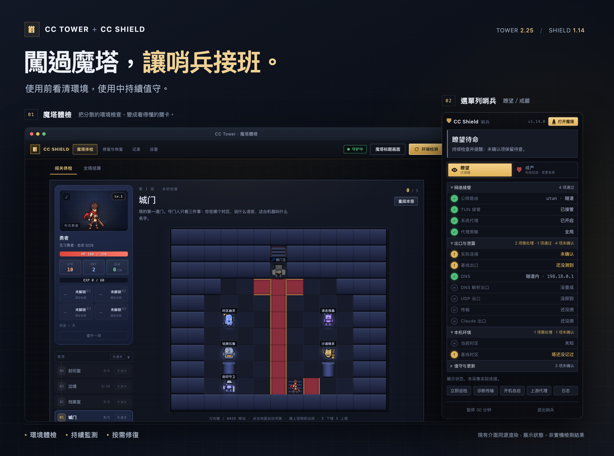
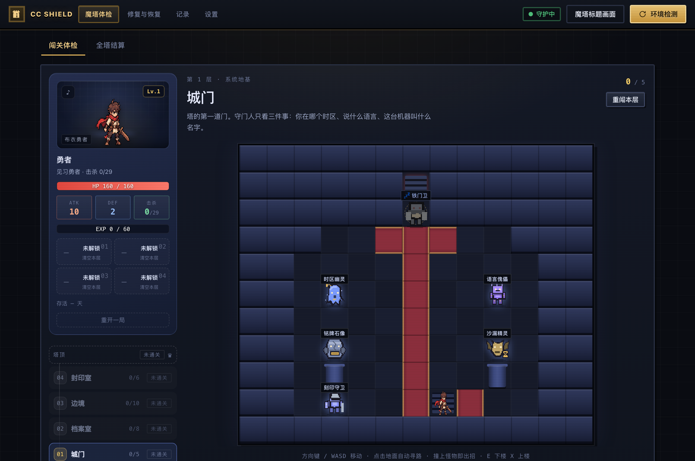
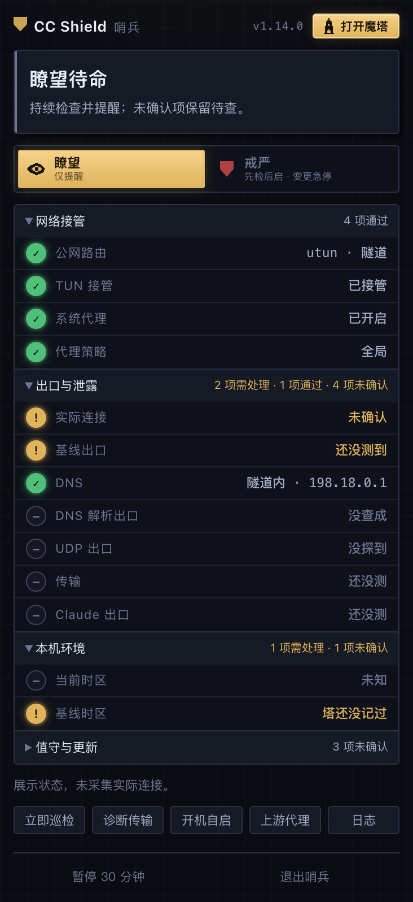

# CC Tower / CC Shield

<details>
<summary><strong>作者的话：为什么做这个魔塔？</strong></summary>

最开始做这个“检测 + 监测 Claude 环境”二合一的 App，是因为 Claude 封了我的账号。我先让 Codex 帮我清理残留文件，接着开始翻网上各种“防封教程”。结果越看，发现需要检查、需要设置的东西越多。折腾的过程中，我又被封了两个账号。

一气之下，我决定把这些检测做成一座 Claude 魔塔，让每一位勇士都来闯一闯，看看谁能坚持得更久。这就是 CC Tower 的由来。

坦白说，这个软件还有很多做得不够完善的地方。很多检测点和设置思路，都参考了网上大家分享的经验和“防封技巧”。但我想把最重要的一句话放在最前面：**即使把使用环境的每一项都做得尽可能完善，账号仍然可能被封。这个软件不能保证防封。**

这是我尽我所能、结合目前所知道的内容，做出来的一套尽量完整的环境检测与监测工具。如果有什么意见和建议，欢迎到下方的交流群里交流，或通过 Issues 反馈。

**希望大家都能用上稳定的 Claude 账号！**

</details>

---

<p align="center">
  
</p>

<p align="center"><strong>闯过魔塔，让哨兵接班。</strong><br/>把使用前的环境体检，接上使用中的持续监测。</p>

<p align="center">
  
  
  
  
  <a href="LICENSE"></a>
</p>

<p align="center">
  <a href="https://github.com/shlo12/cc-tower/releases"><strong>下载应用 →</strong></a>　·　
  <a href="#quick-start">第一次使用</a>　·　<a href="#platforms">三端区别</a>　·　
  <a href="https://github.com/shlo12/cc-tower/issues">反馈与建议</a>
</p>

## 一次体检，一路值守

<table>
<tr>
<td width="33%" valign="top">
<h3>01 · 看清环境</h3>
<p>代理、DNS、IPv6、UDP、时区和本地配置集中查看。五层魔塔呈现进度，每个问题都能回到证据与建议。</p>
<p><strong>先知道哪里有问题。</strong></p>
</td>
<td width="34%" valign="top">
<h3>02 · 持续值守</h3>
<p>菜单栏哨兵随时可看。瞭望负责提醒；戒严先检查后启动，使用中发现命中条件时结束本次桌面会话。</p>
<p><strong>未知保留为未知。</strong></p>
</td>
<td width="33%" valign="top">
<h3>03 · 按需修复</h3>
<p>从问题跳到相应工具，先看说明和预览，再决定执行。受支持的修改提供恢复入口；敏感清理不留原文副本。</p>
<p><strong>改什么，由你决定。</strong></p>
</td>
</tr>
</table>

> **独立项目，由 shlo 维护，非 Anthropic 官方产品。** 不承诺防封或零泄漏；通关与分数不是账号安全认证。图片取自现有前端的同源渲染，使用展示数据，不是当前设备的实测结果。

<details>
<summary><strong>展开查看界面细节：魔塔体检与哨兵面板</strong></summary>

<table>
<tr>
<td width="64%" valign="top">

<p><strong>魔塔体检</strong><br/>把检查拆成能理解的关卡；问题对应证据、建议和处理入口。</p>
</td>
<td width="36%" valign="top" align="center">

<p><strong>菜单栏哨兵</strong><br/>结论、告警、档位优先显示，具体指标按分类展开。</p>
</td>
</tr>
</table>

</details>

<a id="quick-start"></a>
## 从打开到开始使用

1. **打开应用，先看当前状态。** 需要完整检查时点「打开魔塔」，查看体检和问题证据。
2. **只处理与你有关的问题。** 从「修复与恢复」选择工具，阅读说明、预览，再确认；处理后重新检查。
3. **选择值守方式。** 瞭望只提醒。使用戒严前，配置当前平台支持的监测接口，正常退出 Claude，再点「检查后启动」。
4. **用完先结束本次使用。** 确认 Claude 已退出，再调整代理、节点或相关设置。

闯关不会自动替你改完全部系统设置。刻意保留的普通检查项可按规则选择「我已知晓」，结果仍如实显示；层主与塔主不可忽略。

<a id="platforms"></a>
## 选择适合你的版本

| | 普通 macOS | macOS 虚拟机专用 | Windows 11 x64 |
| :--- | :--- | :--- | :--- |
| 日常入口 | 菜单栏 CC Shield | 客机内哨兵与魔塔 | Windows 系统匣哨兵 |
| 网络证据 | 本机代理、TUN、控制 API 与实测出口 | 已部署的固定上游链路与 root pf 证明 | Windows 本机 Mihomo API、系统代理与 TUN |
| 断网保障 | 周期监测及桌面进程处理 | 独立固定链路守护；必须完成专用部署 | 周期监测及桌面进程处理 |
| 体检与维护 | 按平台支持范围提供 | 调整后的专用判据，禁用不适用修复 | 按平台支持范围提供 |
| 当前边界 | 采样有间隙，不是防火墙 | 不把宿主机的 TUN 当成客机的本机 TUN | **1.0.0 Preview，尚未完成实机验收** |
| 使用说明 | [界面与工具](docs/INTERFACE_GUIDE.md) | [虚拟机网络手册](docs/VM_NETWORK.md) | [Windows 手册](windows/README.md) |

三个版本不能只按版本号判断能力是否相同。普通电脑和固定上游虚拟机采用不同判据，Windows 首版的支持范围也较小。

<a id="download"></a>
## 下载与安装

**[前往 Releases 下载应用包 →](https://github.com/shlo12/cc-tower/releases)**

| 版本 | 怎么打开 | 需要知道 |
| :--- | :--- | :--- |
| macOS 11+ · Intel / Apple Silicon | 完整解压，打开 `CC Tower.app`，可拖入「应用程序」 | 自带 Python；ad-hoc 签名，未公证；改名前的老版本首次更新需手动装一次新包 |
| macOS 虚拟机专用 | 使用明确标示为 VM 的专用包，按手册部署后验收 | 普通包不能代替固定链路保护；不要拿它改宿主机网络 |
| Windows 11 x64 · Preview | 完整解压，双击 `Install.cmd` 创建快捷方式，或直接运行 `WindowsShield.exe` | 无需管理员权限；保留随包目录；监测接口和客户端仍需配置 |

自动更新源如需配置，请填写 `shlo12/cc-tower`；默认仍为空，不会自动开启更新检查。

源码当前为 **Tower 2.25.0 / macOS Shield 1.14.0 / Windows Shield 1.0.0 Preview**。下载包以 Releases 实际附件、版本和验收说明为准；主分支更新不会自动替换已有安装包。GitHub「Code → Download ZIP」下载的是源码。

macOS 首次打开时请核对来源及 SHA256，再按系统提示处理。Windows 原生哨兵独立常驻；仅「体检与维护」会启动 Python 本地服务，关闭其终端会结束体检服务。

## 瞭望与戒严，分别做什么？

| 档位 | 使用方式 | 异常时 |
| :--- | :--- | :--- |
| **瞭望** | 持续检查，随时查看证据 | 提醒，不自动结束 Claude |
| **戒严** | 检查通过后启动，绑定本次会话 | 命中退出条件时结束本次桌面使用，重新检查后才能开始下一次 |

**戒严不靠「有一个代理程序」就放行。** 普通 Mac 需要基线、本机代理／TUN／全局模式、可读取节点与关键实测证据；专用 VM 依赖固定链路证明；Windows 依赖首版支持的本机接口。具体缺失、过期或无法确认的证据会阻止准入。

使用中观察到模式、可读取节点或实际出口变化，会按规则结束会话。普通网络波动在接管与会话绑定仍有效等条件下，可进入最长 **120 秒恢复期**；明确直连、接管失效、证书错误等不会靠重试放行。

目前管理的是受支持的 **Claude 桌面客户端**，不是所有浏览器标签页或 Claude Code CLI。系统直接启动仍有启动后处理延迟；周期采样不能覆盖所有短连接，也不能撤回已发出的数据。

<details>
<summary><strong>代理客户端、实际连接和恢复期的具体边界</strong></summary>

- macOS 连接采样可识别 Clash Verge、FlClash、Shadowrocket、Surge 的部分本地监听与连接线索；本地代理连接只证明进入客户端，不证明最终节点一定不是 DIRECT。
- 节点会话监测的支持范围更窄，需要可用本机 HTTP 控制 API；FlClash、Clash Verge、Mihomo Party 等按实际接口与选择链判定。其他客户端或无法确认的选择可以使用瞭望，但不等于已满足戒严准入。
- 运行中通常每 10 秒左右调度巡检，探测本身也耗时；不同节点可能共用出口，采样之间切换再切回也可能未被发现。
- 上游代理与托管 VM 的边界、UDP 主动阻断证明及 pf 有效期见专用手册，不能把上游模式的结果型证据当成固定链路部署完成。
- [普通 Mac 恢复期判据](docs/MAC_RUNTIME_RECOVERY.md) · [虚拟机固定链路](docs/VM_NETWORK.md) · [Windows 首版边界](windows/README.md)

</details>

## 修复之后，能恢复吗？

| 内容 | 保留与恢复 |
| :--- | :--- |
| 缓存、诊断日志 | 不保留副本；删除后不能通过本工具恢复 |
| 已识别的 API 密钥、令牌与凭据 | 不保留明文副本；可能需要重新登录或配置 |
| Shell 密钥赋值 | 移除对应行；其他配置备份也会过滤已识别密钥 |
| 其他支持的修改 | 按项目保留恢复记录、过滤后的备份或移入废纸篓，以预览为准 |

恢复入口不代表所有操作都可撤销。IPv6 设置也只覆盖当前支持的网络服务，不代表所有网卡及未来新增网络都永久禁用 IPv6。

## 数据留在哪里？

本地服务只监听回环地址。体检记录与恢复数据主要在用户目录的 `.ccclean`，Windows 哨兵另用当前用户 DPAPI 加密设置。**不要公开整个数据目录、订阅、凭据或完整日志。**

出口查询、DNS／DoH、STUN、HTTPS 连通性及版本检查会访问相应第三方服务，对方能够看到请求来源。「本地运行」不等于完全离线。完整边界见 [SECURITY.md](SECURITY.md)。

## 常见问题

<details>
<summary><strong>通关就一定不会被封号吗？</strong></summary>

不能。通关只反映本工具的检测规则与证据，无法证明本地设置与服务方账号处置的因果关系。勇士榜保留 shlo 提供的 35 天个人战绩，不是效果验证或安全承诺。

</details>

<details>
<summary><strong>关掉魔塔窗口，哨兵还在吗？</strong></summary>

正常关闭主窗口不等于退出哨兵，菜单栏／系统匣仍可查看。要停止值守，使用哨兵自己的暂停或退出入口。已准入戒严会话在暂停、退出或切换档位前按规则结束。

</details>

<details>
<summary><strong>Windows 和 VM 已经与普通 Mac 完全一样了吗？</strong></summary>

没有。Windows 原生哨兵仍是待实机验收的 Preview；VM 必须使用专用固定链路方案。两者不能直接复用普通 Mac 的全部功能说明。

</details>

<details>
<summary><strong>我只想从源码运行</strong></summary>

需要 Python 3.10+；业务后端使用标准库，前端为 HTML / CSS / JavaScript。

```bash
python3 app.py
```

源码运行不会自动获得编译后的原生哨兵。macOS 构建使用 `sh tools/build-app.sh`；Windows 原生构建见 [Windows 手册](windows/README.md)。分发与隐私检查见 [PUBLISHING.md](PUBLISHING.md)，更新记录见 [RELEASE_NOTES.md](RELEASE_NOTES.md)。

</details>

## 交流与反馈

**[报告 Bug / 提出建议 →](https://github.com/shlo12/cc-tower/issues)**

请说明系统与应用版本、复现步骤、预期和实际结果。截图与日志先脱敏；安全问题按 [安全说明](SECURITY.md) 私密反馈。

微信交流群「Claude魔塔基地」的当前二维码标示在 11 月 5 日前有效，**现已过期，待更新**。在新二维码补上之前，请优先使用 Issues。

<details>
<summary>查看旧群二维码（已过期）</summary>
<p align="center"></p>
</details>

---

<p align="center"><strong>希望大家都能用上稳定的 Claude 账号。</strong><br/><sub>shlo · 独立项目 · GNU AGPL-3.0</sub></p>

项目自有源码遵循 [GNU AGPL-3.0](LICENSE)，第三方运行时保留其原有版权与许可，详见 [THIRD_PARTY_NOTICES.md](THIRD_PARTY_NOTICES.md)。不伪造身份资料，不改变服务端记录；请遵守所用服务条款。
